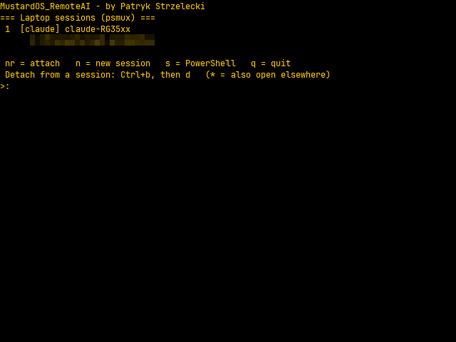
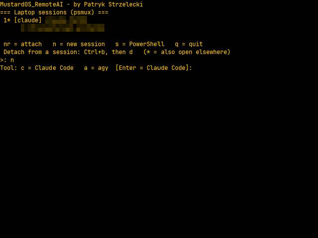
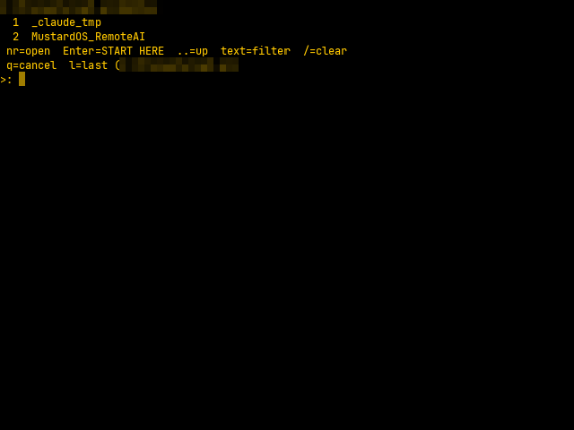
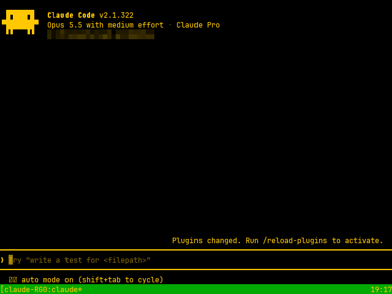
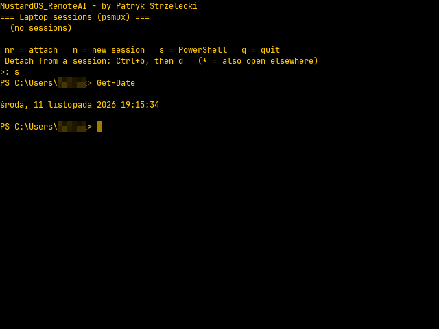

# MustardOS_RemoteAI

**Use a MustardOS (muOS) handheld as a pocket terminal for AI coding agents running on your Windows PC.**

Claude Code, agy and similar CLI agents work for minutes at a time and only now and then need an answer or
a decision from you. MustardOS_RemoteAI lets you do that from the sofa: grab the handheld (e.g. an Anbernic
RG35XX H with a Bluetooth keyboard), open an app, pick a running session and talk to the agent – the same
session that is open on the PC. You can also start new sessions in any project folder from the console.

Author: Patryk Strzelecki

## How it works
```
Handheld (muOS)                                  Windows PC
"Connect to Claude/Agy" app                      OpenSSH Server (key-only login)
  └ terminal → SSH (static Dropbear client) ───▶   └ PowerShell 7 → session menu
                                                       ├ attach to a running psmux session
                                                       └ start a new one: claude / agy / … in a chosen folder
```
- On the PC every AI tool runs inside **psmux** (a native Windows tmux). Typing `claude` in any terminal starts
  it in a session automatically, so it can be attached from elsewhere; closing the window only detaches.
- The console connects with its own SSH key (generated on the console, never leaves it). The PC accepts keys
  only, for one user only, and the firewall only lets the console in.
- New sessions requested from the console are created by an on-demand scheduled task inside your normal
  Windows logon, so tools that keep their login in Windows Credential Manager (agy) stay signed in.
- Nothing runs in the background except the `sshd` service; a psmux server exists only while a session is open.
- A second app, **Connect to PowerShell**, gives you a plain PowerShell 7 prompt on the PC.

Details: [docs/HOW-IT-WORKS.md](docs/HOW-IT-WORKS.md).

## Screenshots
Real screenshots taken on an Anbernic RG35XX H (640×480, muOS); paths and private names are blurred.

| Session menu | New session – pick a tool |
|---|---|
|  |  |
| **Directory browser** | **Claude Code running on the PC, shown on the console** |
|  |  |
| **Connect to PowerShell** | |
|  | |

## Installation
Requirements: Windows 10/11 with PowerShell 7 and the AI CLIs you use; a muOS console with SSH enabled
(default `root`/`root`) on the same network. The installer adds psmux (winget) and Windows OpenSSH Server.

1. Clone this repository on the PC (the scripts run from this folder).
2. Copy `mustardos-remoteai.conf.example` to **`mustardos-remoteai.conf`** and fill in your addresses, Windows
   user, projects folder, AI tools and console login. This one file holds all settings and secrets – it is in
   `.gitignore`, so it never ends up in the repository.
3. Run in PowerShell 7: `.\install.ps1` – sets up the PC, uploads the client and the two apps to the console
   (and creates the console key), then configures OpenSSH Server (UAC prompt).
4. On the console open Applications → **Connect to Claude/Agy**.

Re-run `.\install.ps1 -Steps console` after changing console-related settings; `-DryRun` shows what would be done.
Usage, configuration keys and troubleshooting: [docs/USAGE.md](docs/USAGE.md). Removal: [docs/UNINSTALL.md](docs/UNINSTALL.md).

## License notes
`console/mustardos_remoteai/dropbearmulti` is a static build of the Dropbear 2025.88 SSH client
(github.com/mkj/dropbear), license in `console/mustardos_remoteai/DROPBEAR-LICENSE`.
